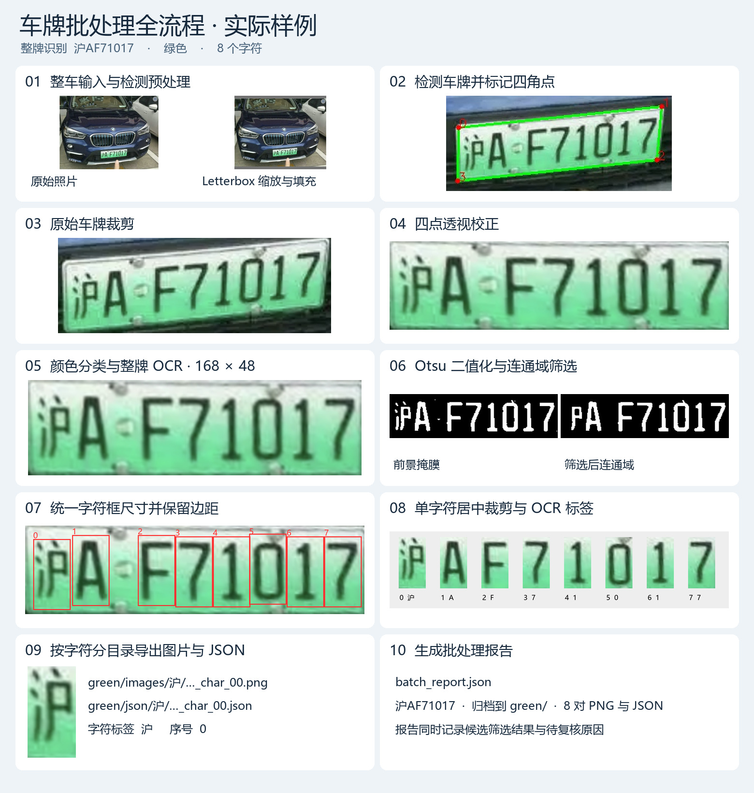

# 车牌批量处理

打开 `run.py`，把 `IMAGE_FOLDER` 改成存放整车照片的目录。保留路径两侧的引号和前面的 `r`。保存后双击 `run.cmd`。会扫描子目录，支持 JPG、JPEG、PNG 和 BMP。

## 全流程效果



每次运行在 `results` 下生成一个带时间的结果目录。

| 路径 | 内容 |
| --- | --- |
| `blue/images/字符/`、`green/images/字符/` | 居中留边的单字符 PNG。同一车牌内的尺寸一致 |
| `blue/json/字符/`、`green/json/字符/` | 同名字符标注，标签来自整牌 OCR |
| `blue/`、`green/` | 蓝牌、绿牌分别归档，各自包含原始裁剪和透视校正图 |
| `detection/` | 整车角点图、检测坐标及待复核候选裁剪 |
| `blue/previews/`、`green/previews/` | 二值化图、字符框图和 OCR 标签对照图 |
| `batch_report.json` | 每张照片的检测结果，以及候选车牌的识别、分割或拒绝原因 |

可在项目目录用 Python 3.9 创建环境并安装依赖。

```powershell
py -3.9 -m venv .venv
.\.venv\Scripts\python.exe -m pip install -r requirements.txt
```

模型和部分代码来自 we0091234 的 [Chinese_license_plate_detection_recognition](https://github.com/we0091234/Chinese_license_plate_detection_recognition)。许可见 `LICENSE`。
